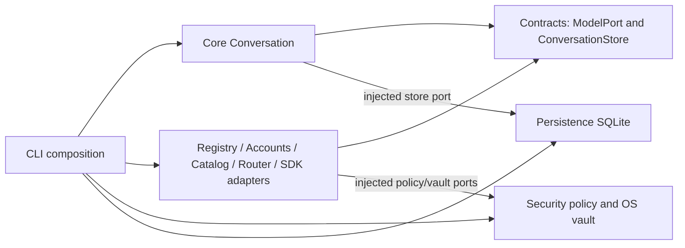

# Providers and authentication: implemented PA1 slice

Contract/storage version 1; scope authorized by [ADR 0005](../adr/0005-provider-auth-product.md). See the [verification matrix](../compatibility/providers-auth-matrix.md) before treating a named service as live-verified.

## Ownership and runtime

CLI is the composition root. `contracts` exports strict data schemas and injected ports. `models` owns ProviderRegistry, AccountManager orchestration through CredentialVault/SettingsStore ports, ModelCatalog, ProviderTransport, ProviderAdapter and ModelRouter. `security` owns endpoint/network policy, OS vault and redaction. `persistence` owns all durable SQLite configuration, catalog and transcript writes. `core` imports only contracts and owns a model-only Conversation. It persists a pending turn before invocation and commits the answer only after terminal completion and stream exhaustion. Interrupted/failed turns are excluded from subsequent model context. Full agent events, tool execution and resume are not implemented.



Runtime arrows to injected implementations do not add compile-time package dependencies. Adapters never receive privileged tool callbacks. Model tool arguments are validated data only. Unknown tools/capabilities are denied; core does not dispatch any tools. Text chat is explicitly selected by the user even when metadata is unknown.

## Configure and connect

Use `bun run cosmew` as the local command prefix below; `cosmew` is also the workspace CLI bin when Bun's bin directory is on PATH. `bun run cosmew --help` lists all options.

- `providers list` shows configured entries and available presets separately. Presets: OpenAI Responses, Anthropic Messages, Gemini, OpenRouter Chat and Ollama Chat.
- `providers add <id>` accepts `--url`, `--protocol`, `--catalog`, `--auth`, `--name`, `--timeout-ms`. Adding a provider never claims connection success. To change an endpoint, remove its accounts then remove/recreate the provider; in-flight bindings never silently change.
- `auth login --provider <id> --alias <alias>` reads a hidden API key into OS keyring, then validates the account. Interactive provider/alias prompts are available if options are omitted. `--method none` is explicit for local/public services. `--method env --env VARIABLE_NAME` keeps only the reference. `--key-stdin` stores a secret-manager pipe in keyring; do not pipe keys into chat.
- `auth login --account <existing-id-or-alias> --env VARIABLE_NAME` or hidden key input reauthenticates the stable identity. It fences old authorization and deletes old keyring credentials first. If rotation fails, the identity stays safely logged out/unvalidated and can be retried.
- `providers test --account <alias>` verifies current discovery. `--generate` verifies a small generation and may incur provider costs. Manual-only gateways require a model and validate generation during login.

A new identity is first `unvalidated`. Missing/rejected credentials become `invalid`; a network outage does not claim successful authentication. Model-discovery validation and generation validation are reported separately. Public `/models` endpoints may not validate authentication at all, so `auth status` reports historical checks, credential availability and does not promise paid entitlement. `auth methods` gives the actual supported methods. Unsupported subscription/delegated methods fail with `UNSUPPORTED` and the API-key/official-CLI alternative.

## Gateway URL + model

```sh
bun run cosmew providers add my-9router --url https://your-gateway.example/v1 --protocol responses --catalog manual
bun run cosmew auth login --provider my-9router --alias router-main --model your-model-id
bun run cosmew model doctor --generate
bun run cosmew
```

This implements the user's clarified 9Router workflow without assuming a vendor/project. `--catalog manual` skips `/models` and makes a real small request to the chosen model for validation; arbitrary saved strings are not login success. For a Chat gateway choose `--protocol chat`; usage streaming extensions are off by default on custom Chat endpoints. Add `--stream-usage` only if the endpoint supports `stream_options.include_usage`. OpenRouter/Ollama presets enable it. Unknown usage is null.

Ollama uses `http://127.0.0.1:11434/v1` for Chat and `/api/tags` for discovery. Start/install Ollama yourself and pull a model first; Cosmew never installs a local daemon. Remote endpoints require HTTPS. HTTP is allowed only on explicit loopback hosts. URL credentials, query strings, fragments and redirects are rejected. Credentials never move to another origin through redirects.

## Models and accounts

```sh
bun run cosmew models list --account personal
bun run cosmew models search claude --account work
bun run cosmew models info <model-id> --account work
bun run cosmew models select <model-id> --account work
bun run cosmew models add <manual-model-id> --account work
bun run cosmew models list --offline
bun run cosmew models sync-metadata
bun run cosmew accounts list
bun run cosmew accounts use personal
bun run cosmew accounts rename personal --alias personal-new
bun run cosmew auth status --account personal-new
bun run cosmew auth logout --account personal-new
bun run cosmew accounts remove personal-new
```

IDs are UUIDs independent of aliases/provider/model IDs. Alias uniqueness is global to avoid ambiguous commands. A selected model is saved as the account default. Using an account without a default clears the current selection; select a model before requesting generation. `models select --project` stores an explicit preference keyed by the current absolute directory in private user state, not in a repository file; `cosmew --project` uses it. Cosmew does not auto-load executable or repository provider configuration.

Catalog caches are account-specific and endpoint-fingerprinted, with fetch times. Offline fallback occurs only for transport/timeouts, never to hide auth/protocol errors. Manual records remain unknown until an invocation succeeds; even success on one operation does not establish tools/vision/reasoning compatibility. `--capability tools|streaming|vision|reasoning|text` filters verified fields; unknown does not count as supported. Current discovered/manual records keep capabilities unknown. There is no fabricated fixed model list.

`sync-metadata` explicitly fetches Models.dev without provider credentials or prompts; context/output limits and USD price estimates get source/fetch timestamps. It does not add available models or upgrade capability claims. Cost is null until both provider usage and a price snapshot exist; advisory metadata can be stale. Request output limits are clamped by metadata when present. For chat/run, `--max-estimated-cost-usd 0.01` denies unknown pricing or an estimate above the limit before any prompt is sent. It uses serialized input bytes plus framing allowance and output-token limit; the cost is explicitly an estimate, not an exact tokenizer or billing guarantee. Reported usage cost carries `costEstimated: true` when calculated from advisory prices. Context overflow is bounded by local message/byte ceilings and provider diagnostics; exact provider token counting and hard dollar-budget enforcement remain Not implemented.

## Chat and scripts

```sh
bun run cosmew
printf 'Hello\n' | bun run cosmew run --json
bun run cosmew --max-output-tokens 1024
```

Start `bun run cosmew` and type `/login`; no prior account/model configuration is required. The guided wizard lists existing accounts and provider presets, supports new gateways through URL/protocol/model, hidden OS-keyring entry or environment references, validates the connection, then selects a model and starts fresh context. Menu answers accept numbers/IDs; model lists show up to 20 entries at once and accept search keywords. `/login <alias-or-id>` reuses or reauthenticates a stable account. `/logout [alias-or-id]` deletes local credentials through the same account manager and leaves the CLI open; the current context is discarded on current-account logout. `/status` works while signed out. `/cancel` at a wizard question returns to chat; Ctrl-C exits 130.

Chat and the login wizard share one input owner with terminal history disabled and echo suppressed for secret entry, so login answers/keys are not submitted as chat. Hidden keys require a real terminal; piped wizard scripts must choose an environment reference. The real PTY test verifies key masking, history isolation, login, message send and logout using the native macOS credential store.

Other interactive commands are `/models`, `/model <id>`, `/accounts [alias]`, `/status`, `/connect`, `/connect <provider> <alias> <ENV_NAME> [model-id]`, `/new`, `/exit`. Bare `/connect` opens the same login wizard; its argument form remains a scripting shortcut. `/accounts` or `/model` switching starts a fresh conversation; prior prompts are not forwarded. Unknown capability/tool requests fail closed. Generation errors do not switch endpoints or retry partial output. Ctrl-C aborts and exits 130; restart or explicitly reissue the failed turn. `run` reads a single message from stdin and exits nonzero on failure. There is no `--api-key` argument. `--json` on run returns one JSON response; other commands return JSON records/arrays.

Transcript messages are durable, but resume/recovery commands are not implemented. Protect `~/.cosmew` and disk encryption: SQLite stores prompts/responses without application-level encryption, and removing an account does not erase past conversations. No raw prompt telemetry or debug provider-body logs are enabled.

## Storage and troubleshooting

The state root is `~/.cosmew` or an explicitly set `COSMEW_HOME`. It must be owned by the current user with mode 0700; the database is mode 0600. Insecure roots and direct store symlinks fail closed. SQLite schema 1 rejects newer schemas; no automatic downgrade. macOS uses Keychain, Linux explicitly requires Secret Service, Windows uses the package's credential-store backend. macOS has local runtime evidence; Linux/Windows remain pending. No keyring backend falls back to plaintext; use environment references where the backend is unavailable. Environment values remain accessible to your process/user and should be injected by a secret manager, not pasted into shell history.

| Diagnostic | Recovery |
|---|---|
| AUTH / FORBIDDEN | Check API billing/entitlements and env availability; reauthenticate the existing account. Consumer plan is not an API key. |
| NOT_FOUND | Check base URL/protocol and model ID; refresh catalog, or add a manual ID for a gateway without discovery. |
| RATE_LIMIT | Wait the provider interval; explicitly select another account if desired. No silent fallback. |
| TIMEOUT / TRANSPORT | Check TLS/network/server and timeout; remote generation may have occurred, so retry explicitly. Offline catalog is marked stale. |
| PROTOCOL | Verify the configured protocol and gateway stream format; disable unsupported usage extensions; incomplete output is not a committed answer. |
| STORAGE | Check OS keyring unlock/service and private-directory ownership/modes. No plaintext fallback. A failed logout deletion can be retried by explicit account ID. |
| POLICY | Select an account/model; a changed/logout credential invalidates old authorization. Reconnect explicitly. |
| BUDGET | Refresh advisory metadata or explicitly change the estimated-cost limit; unknown pricing fails closed. This guard is not a provider billing ceiling. |
| UNSUPPORTED | API credentials or official CLI separately; delegated agents require a separate security integration. |

Logout deletes the local keyring entry and clears selections, project references and catalog; API keys have no standard remote revoke endpoint, so revoke them in the provider console. Environment refs are fenced locally; Cosmew cannot unset your parent shell variables. Authentication generations prevent late validations from reviving a logged-out/rotated account. The same root policy is rechecked for new HTTP operations and streamed wire chunks, but cancellation cannot undo provider processing already accepted.


## Provider Connect TUI and canonical commands

[Current usage and complete command audit](../delivery/provider-connect-acceptance.md) supersede the older line-wizard-only instructions above. Use `bun run cosmew`, `/login`, `/model`, then chat. The TUI includes all account lifecycle actions, custom endpoint discovery/manual configuration, explicit cancellation/rollback and OS-keyring/environment/no-auth flows. OpenRouter's official headless OAuth PKCE is available in the TUI and guided line wizard; no third-party subscription entitlement is implied. Shared validation probes OpenRouter `/key` before discovery. `/status` reports historical validation; `/doctor` checks live. Unsupported MCP/plugin/compaction/policy-editing/shell capabilities are diagnosed. No auth plugin host is enabled.


Current subscription and reduced login steps: [usage/evidence](../delivery/subscription-auth.md). Account names are generated, not required input. Saved-account login reuses valid credentials without an extra confirmation. Vendor rows group API and subscription methods.
